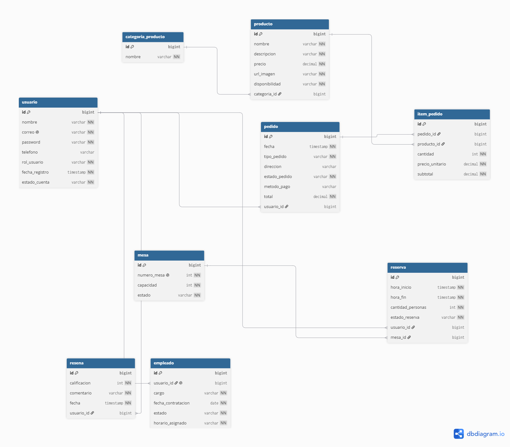

# JFRestaurantSistem

Plataforma web para gestión y reservas de restaurantes: menú digital,
pedidos a domicilio, reserva de mesas, reseñas y panel de administración.

## Estado del proyecto
✅ Proyecto completo y desplegado.

**Demo:** https://jf-restaurant-sistem-front.vercel.app
> El backend está en un plan gratuito: si estaba inactivo, la primera carga puede tardar hasta un minuto.

### Completado
- ✅ Configuración inicial y conexión a PostgreSQL
- ✅ Entidad Usuario, Rol y EstadoUsuario
- ✅ Autenticación con Spring Security + JWT (registro y login)
- ✅ Menú: CRUD de productos y categorías, con rutas protegidas por rol
- ✅ Pedidos: creación, historial, cambio de estado, cancelación, listado admin
- ✅ Reservas y Mesas: creación con validación de solapamiento, liberación automática por tiempo, cancelación, listado admin
- ✅ Reseñas: calificación de 1 a 5, comentario, listado paginado, promedio general
- ✅ Empleados: CRUD para el panel de administración (cargo, fecha de contratación, horario, estado)
- ✅ Manejo global de excepciones personalizadas
- ✅ Documentación interactiva con Swagger / OpenAPI
- ✅ Frontend completo desarrollado con React, Vite y CSS
- ✅ Gestión de usuarios y roles desde el panel (un admin puede promover a otro)
- ✅ Configuración del restaurante centralizada (nombre, logo, textos, horarios y colores en `frontend/src/config.js`)
- ✅ Despliegue en la nube (neon, vercel, render)

## Stack
- Backend: Java 25, Spring Boot 4, Spring Security, JWT, PostgreSQL
- Frontend: React, Vite, CSS
- Despliegue: Vercel (frontend), Render (backend con Docker), Neon (PostgreSQL)
- Documentación: Swagger / OpenAPI
> **Nota:** El backend (diseño de la API, seguridad y reglas de negocio) lo desarrollé yo. El frontend lo construí con ayuda de un agente de IA (Claude), y lo estoy estudiando y ajustando mientras avanzo hacia full stack.

## Estructura del repositorio
```
JFRestaurantSistem/
├── backend/     ← API REST en Spring Boot
├── frontend/    ← Interfaz de usuario (React + Vite + CSS)
└── docs/
    ├── diagrama-er.png
    └── postman/
        └── JFRestaurant API.postman_collection.json
```


## Modelo de datos


## Configuración local

Este proyecto usa variables de entorno para las credenciales. Antes de correrlo, configura en tu IDE (o en tu sistema):
- `DB_URL` — URL de conexión a PostgreSQL, ej. `jdbc:postgresql://localhost:5432/tu_bd`
- `DB_USERNAME` — usuario de PostgreSQL
- `DB_PASSWORD` — contraseña de PostgreSQL
- `JWT_SECRET` — clave aleatoria de al menos 32 caracteres (genera una con `openssl rand -base64 32`)
- `CORS_ORIGINS` — dominios del frontend permitidos por CORS, separados por coma. Por defecto `http://localhost:5173`. En producción, la URL del frontend desplegado.
- `PORT` — puerto del servidor. Por defecto `8080`.
- Para el frontend, ver [`frontend/README.md`](frontend/README.md).

## Probar la API
- **Swagger UI**: `http://localhost:8080/swagger-ui/index.html` (con el backend corriendo)
- **Colección de Postman**: `docs/postman/JFRestaurant API.postman_collection.json`

